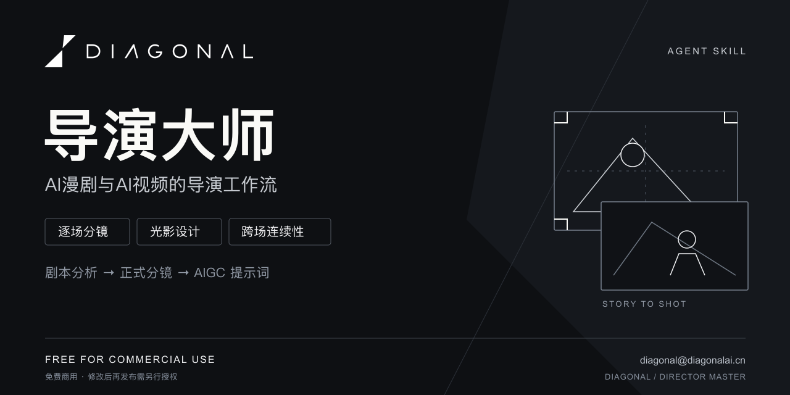

# DIAGONAL导演大师

[](https://skills.sh/xiaocaochi-collab/diagonal-director-master/diagonal-director-master)

作者：**DIAGONAL**

工作邮箱：[diagonal@diagonalai.cn](mailto:diagonal@diagonalai.cn)

微信：**Cheeeed_zh**

把第三人称短片剧本逐场拆解成可执行的文字分镜，并管理光影、表演、剧情时间与跨场连续性。

适合需要持续推敲镜头、保留创作决定，并把正式分镜进一步转成 AIGC 提示词的AI漫剧、AI视频生成的创作者。

## 一条命令安装

需要 Node.js **22.20.0 或更高版本**（用于运行当前 skills CLI）：

```sh
npx skills add xiaocaochi-collab/diagonal-director-master
```

按安装器提示选择宿主和安装范围。已使用 skills CLI 1.7.2 验证 Codex 项目安装：脚本、专业模块、品牌素材与中文启动文件完整复制。安装不会自动配置 Python 或安装 Pillow，运行环境见下方“环境与安装”。

[在 skills.sh 查看与安装](https://skills.sh/xiaocaochi-collab/diagonal-director-master/diagonal-director-master) · [下载完整安装包](https://github.com/xiaocaochi-collab/diagonal-director-master/releases/latest)

## English overview

**DIAGONAL Director Master** is an agent skill for creators of AI comics, short films, and AI-generated videos. It turns third-person scripts into shot-by-shot storyboards, with lighting design, performance direction, duration checks, and continuity tracking. It also prepares Midjourney location prompts and Seedance 2.0 video prompts, and organizes production assets in a local library.

**Requirements:** Python 3.10+; Pillow for emotion-curve charts. The current skills CLI requires Node.js 22.20+. Installation has been verified with Codex; other hosts require their own compatibility checks. The directing workflow and outputs are primarily in Chinese.

**License:** Free for commercial use. Republishing modified versions, repackaging, or redistributing the skill requires separate written permission. See [LICENSE](LICENSE). **Contact:** [diagonal@diagonalai.cn](mailto:diagonal@diagonalai.cn) · WeChat: `Cheeeed_zh`.

## 能做什么

- **逐场分镜**：分析本场重点、设计镜头简稿、预览与自检、细化必要状态、正式定稿。
- **导演设计**：观众视点、人物表演、全片情绪曲线、场景灯光与镜头可读性。
- **跨场连续性**：剧情时间、服装妆发、关键物品、特殊状态和固定光源变化。
- **动作戏**：支持写实与武侠方向；剧本概括动作过程时，先展示动作编排，由用户接受后进入分镜。
- **派生提示词**：按需生成中文 Midjourney 场地图提示词，把已定稿镜头编译成 Seedance 提示词。
- **本机资产库**：用本地网页管理分镜、提示词、人物、场景与道具素材。

本工具产出文字、提示词和情绪曲线图。图像与视频的实际生成需要在对应工具中完成。

## 环境与安装

需要能读取本地 skill、运行 Python 脚本和读写项目文件的宿主。分析参考图时还需要宿主具备图片理解能力。

- Python **3.10 或更高版本**。
- 资产库、事务写入和容量估算使用 Python 标准库。
- 绘制情绪曲线需要 Pillow，以及支持中文的系统字体。
- 已提供 macOS、Windows 启动文件；跨平台行为仍需在实际目标系统验证。

将整个 `diagonal-director-master` 文件夹复制到宿主的 skill 安装目录。例如使用 Codex 时，可放在 `~/.codex/skills/diagonal-director-master/`。保留 `references/`、`scripts/`、`assets/` 和 `agents/` 的相对位置。

在技能目录中安装绘图依赖：

```sh
python3 -m pip install -r requirements.txt
```

Windows 可将 `python3` 换成 `py -3`。若系统限制全局安装 Python 包，可使用虚拟环境，并让宿主使用该环境的解释器。

## 开始使用

在宿主中调用：

```text
使用 $diagonal-director-master，帮我把这份剧本逐场拆成分镜。项目名称是《片名》。
```

也可以只使用其中一项能力：

```text
使用导演大师，为这个场地生成中文 Midjourney 场地图提示词。
```

```text
使用导演大师，把本项目第2场已定稿分镜转成 Seedance 提示词。
```

```text
打开导演资产库。
```

## 两种工作模式

每场先展示分析，再选择本场的执行方式：

| 模式 | 使用方式 |
| --- | --- |
| 正常模式（默认） | 逐步确认镜头方案，适合精细推敲。 |
| 工业模式 | 接受本场分析后，自动完成本场后续设计、自检与定稿；下一场重新选择模式。 |

两种模式都保留剧本事实与已锁定决定。剧本只概括动作过程时，具体动作方案仍需单独接受。缺少关键事实、存在冲突或必须改编剧本时，工具会集中提出待裁决项。

## 本机资产库

默认保存到当前使用者的：

```text
~/Documents/Codex/DIAGONAL资产库/
```

可以通过 `DIAGONAL_ASSET_HOME` 环境变量或脚本的 `--root` 参数指定其他目录。

在技能目录运行：

```sh
python3 -B scripts/asset_server.py start --open
```

macOS 也可双击 `打开资产库.command`，Windows 可双击 `打开资产库.cmd`。浏览器地址由启动器返回，不固定端口。

macOS 如果提示启动文件没有执行权限，在技能目录运行一次：

```sh
chmod +x 打开资产库.command
```

网页用于本机文件管理，不提供云同步。项目成果保存在资产库中，模型工作记忆与事务记录放在隐藏目录。不要把个人资产库一起提交到代码仓库。

## DIAGONAL 署名

正式文档默认在末尾标注“制作工具：DIAGONAL导演大师”；情绪曲线图使用底部品牌署名。资产库沿用 DIAGONAL 黑白标识。

署名不进入剧本对白、镜头画面描述或可复制的生成提示词。上传图片、视频与下载原文件保持原样。用户可要求调整或移除成果署名；无署名曲线图使用 `--no-branding`。具体规则见 [品牌与成果署名](references/brand-presentation.md)。

## 文件结构

```text
diagonal-director-master/
├── SKILL.md          技能入口与路由
├── agents/           宿主展示信息
├── references/       导演工作流与专业模块
├── scripts/          资产库、事务、容量估算与绘图脚本
├── assets/           本地网页与 DIAGONAL 标识
├── tests/            自动化检查
└── requirements.txt  绘图依赖
```

专业参考的来源链接保留在对应模块末尾。

## 使用许可

采用 [DIAGONAL 免费使用许可](LICENSE)：

- **允许免费商用**：个人与组织可以使用本技能制作、交付和商业使用自己的作品，无须支付工具使用费或分成。
- **修改后发布须另行授权**：再分发原版、发布修改版、重新打包成技能或插件等，需要 DIAGONAL 事先明确的书面授权；单纯署名不代替授权。
- **作品归属保持独立**：许可针对技能本身，不对使用者的剧本、素材和原创成果主张权利，也不强制要求作品保留工具水印。

这是允许免费使用的自定义许可，包含再发布限制，不属于标准开源许可。适用法律与发布平台条款已经授予的权限按其规定处理；具体范围以许可正文为准。

## 维护检查

在技能目录中运行：

```sh
python3 -B -m unittest discover -s tests -v
```

这些检查覆盖文件与部分工具行为，不能代替对镜头表达和实际生成效果的判断。

---
DIAGONAL · DIRECTOR MASTER
